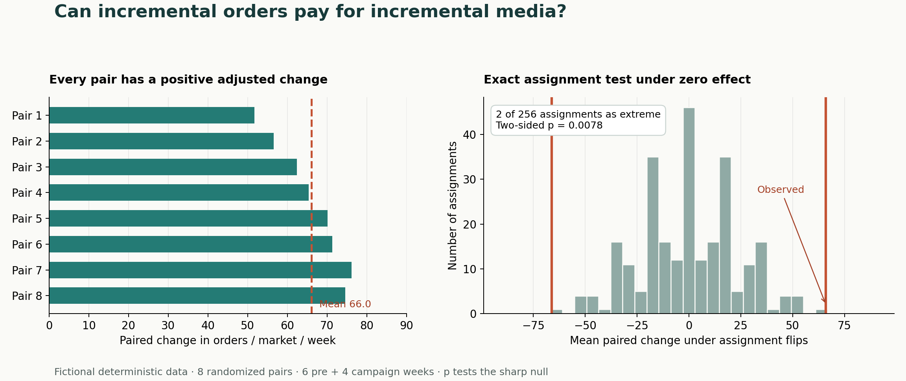

# Xander Phoenix | Decision science and data products

I build models and tools for decisions about customers, marketing spend and product growth. These two projects show how I work through a result before someone acts on it.

## Would an increase in media spend pay for itself?

A campaign-period comparison in this **synthetic experiment** suggests 141 additional orders per market-week. Once the analysis accounts for differences that were already present before the campaign, the estimate falls to **66**. At $80,000 in incremental spend, each incremental order would need to contribute **$37.85** to break even.

[Read the geo experiment, inspect the data and reproduce the calculation](projects/geo-incrementality/README.md)



## Could an LLM decide which support ticket to handle first?

In my original local-model experiment, **20 of 21 tickets received High priority**. Its time estimates mixed first contact, initial assessment and resolution. The follow-up analysis rebuilds those findings from the saved outputs, so a reviewer can see where the model would leave a support lead with the same decision they started with.

[Read the support-ticket case study](projects/support-triage/README.md) · [Open the reproducible notebook](SupportTickets.ipynb)

## Run the analyses

From a clone of this repository with Python 3.11 or later, both analyses run offline with the standard library.

```sh
python projects/geo-incrementality/geo_case.py
python projects/support-triage/analyze.py --check
```

Dallas, Texas · [LinkedIn](https://www.linkedin.com/in/xanderphoenix2/)
