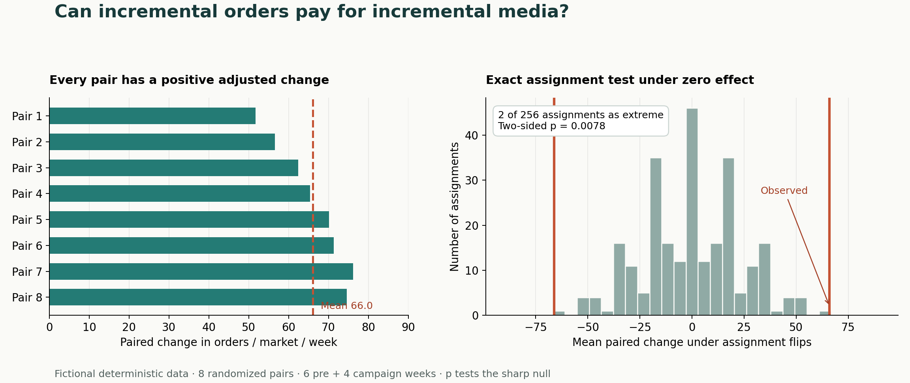

# A geo experiment for a media spending decision



**Synthetic experiment.** The code generates all market-week observations and assignments. Media spend and margin are stated scenario inputs.

## The decision

Suppose a team can buy incremental media in eight test markets for four weeks. Is the added order contribution enough to cover **$80,000** of added media spend? At an assumed **$45 contribution per incremental order**, the synthetic estimate is **2,113.3 incremental orders**, or **$95,100 contribution** and **$15,100 after media**. This is a positive *scenario estimate*, conditional on the design and margin assumptions below.

| Quantity | Synthetic result | Interpretation |
| --- | ---: | --- |
| Naive campaign-period treated minus control gap | 140.94 orders / market / week | Mixes pre-existing market differences with campaign effect |
| Paired difference-in-differences | 66.04 orders / market / week | Estimated incremental rate across the eight treated markets |
| Exact two-sided assignment test | 2 / 256; p = 0.0078125 | Tests the sharp null of zero effect in every market, given the paired assignment |
| Estimated incremental orders | 2,113.33 | 66.0417 × 8 treated markets × 4 weeks |
| Break-even contribution per order | $37.85 | $80,000 / 2,113.33 estimated orders |

The naive gap is about 75 orders higher because the seeded assignment happens to put more high-baseline markets in treatment. Subtracting each market's six-week pre-period mean, then comparing changes within its pair, removes that stable baseline difference. The eight pair estimates range from **51.75 to 76.17** orders per market per week.

## Design and computation

There are eight matched pairs, two markets per pair, six pre weeks and four campaign weeks (160 market-week observations). A fixed seed chooses one treated market independently in each pair; the untreated order path is a deterministic function of pair size, a fixed market intercept, a shared weekly trend and seasonality, and a small market-week deviation. After assignment, treatment adds **55 + 3 × pair index** orders to each campaign week in the assigned market. The injected effect averages 65.50 orders per market-week. The estimate of 66.04 is 0.54 above that known value in this realization. The generating formula and seed are in [geo_case.py](geo_case.py); [market_week.csv](market_week.csv) is its reproducible output. The data are deliberately simple enough to audit, and the injected effect is known only because this is a simulation.

For pair *i*, the estimator is:

`[(treated post mean − treated pre mean) − (control post mean − control pre mean)]`.

The reported estimate is the unweighted mean of those eight pair estimates. The exact randomization test flips the treatment label within each pair, enumerates all **2⁸ = 256** assignments, and counts assignments whose absolute mean contrast is at least as large as observed. It includes ties. If all observed pair contrasts are zero, every assignment ties and p = 1. The test is valid for the **sharp null that treatment changes no market-week outcome**, assuming the pair-level assignment was randomized as specified. The p-value is not a probability that the campaign is profitable, and it is not a confidence interval for order lift.

## Decision sensitivity and limits

Removing one pair at a time puts the mean paired estimate between **64.60 and 68.08** orders per market per week. This is a small-sample influence check, **not** a confidence interval. At the estimated order volume, a $35 contribution margin would produce about **$6,033 below media cost**; at $45, the scenario is $15,100 above. The finance decision therefore depends on the real contribution margin, fulfillment capacity, and any additional variable costs.

In actual deployment, the paired change is credible only if untreated treatment and control trends would have remained comparable, markets do not spill media or demand into each other, measurement is stable, and the planned media difference is delivered. Pre-period trend diagnostics, geography and media-delivery checks, and a prespecified decision threshold would be needed before using this design operationally. This example makes no claim about external validity, real-world uncertainty bounds, or observed customer lift.

## Reproduce

Core analysis and tests need Python 3.11+ and no packages:

```powershell
python geo_case.py --csv market_week.csv
python -m unittest discover -s . -p 'test_*.py' -v
```

Regenerate the chart with matplotlib 3.10.8 (or a compatible version):

```powershell
python render.py
```

The retained synthetic CSV and PNG were generated by those commands. The tests cover a known constant effect, the exact zero-effect null and tie handling, and deterministic one-market-per-pair assignment.
